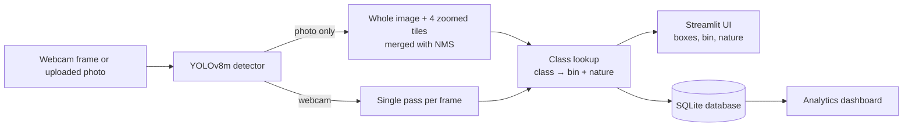

# 🗑️ Smart Waste Management System

An AI-powered Streamlit application that detects waste items from a **live webcam feed** or an **uploaded photo**, assigns each item to one of **8 waste classes**, tells you which **bin** it belongs in, and decides whether it is **biodegradable, non-biodegradable or hazardous**. Every observation is logged to a local database and shown on an analytics dashboard.


> **Disclaimer:** This is an academic / demonstration project. The portal-style interface is a design theme only. The project is not affiliated with, or endorsed by, any government body, and its bin assignments do not replace local municipal rules.

---

## 📑 Table of Contents

1. [Features](#-features)
2. [How It Works](#-how-it-works)
3. [Waste Classes](#-waste-classes)
4. [Quick Start](#-quick-start)
5. [Using the Application](#-using-the-application)
6. [Model Information](#-model-information)
7. [Known Limitations](#-known-limitations)
8. [Project Structure](#-project-structure)
9. [Configuration](#-configuration)
10. [Troubleshooting](#-troubleshooting)
11. [Future Enhancements](#-future-enhancements)

---

## 🌟 Features

- **Live webcam detection**: real-time bounding boxes with class, confidence and bin guidance
- **Photo upload analysis**: drag and drop JPG, PNG, BMP or GIF images
- **Mixed-waste photos**: every prediction in a photo is listed (not just the best one), each tagged High / Medium / Low confidence
- **Zoomed-in tile scan**: a photo is analysed whole and as four overlapping zoomed tiles, then merged, so small items in cluttered piles are not missed
- **8 waste classes**: plastic, metal, glass, e-waste, medical waste, paper, cardboard, organic waste
- **Biodegradable / Non-biodegradable / Hazardous** label for every detection
- **Bin recommendation** and schedule reference for each class
- **Analytics dashboard**: totals, class distribution, confidence over time, source split, per-image reports and a downloadable CSV of the history
- **Adjustable confidence threshold** and camera selection in the sidebar
- **Works on CPU**, no GPU required

---

## ⚙️ How It Works



1. **Detection:** YOLOv8m finds waste items and predicts one of 8 classes.
2. **Photo uploads** are run on the full image plus four overlapping zoomed tiles. Overlapping boxes of the same class are merged, and all remaining predictions are listed.
3. **Nature decision:** each class maps to a nature (for example paper → biodegradable). `medical_waste` is always **Hazardous**.
4. **Output:** the UI shows the bin and nature, and the detections are saved to SQLite for the dashboard. All items found in one uploaded photo are saved under one image report ID.

---

## 🗑️ Waste Classes

| Class | Icon | Bin | Nature | Notes |
|-------|------|-----|--------|-------|
| `plastic` | ♻️ | Yellow Bin | Non-Biodegradable | Recyclable plastic items |
| `metal` | 🔩 | Blue Bin | Non-Biodegradable | Metal items, including cans |
| `glass` | 🍾 | Green Bin | Non-Biodegradable | Bottles and containers |
| `e_waste` | 💻 | E-Waste Bin | Non-Biodegradable | Electronics, including cables |
| `medical_waste` | 💉 | Red Bin | **Hazardous** | Medical and hazardous waste |
| `paper` | 📄 | Blue Bin | Biodegradable | Paper and documents |
| `cardboard` | 📦 | Blue Bin | Biodegradable | Cardboard boxes |
| `organic_waste` | 🍃 | Green Bin | Biodegradable | Food and other organic waste |

---

## 🚀 Quick Start

### Prerequisites

| Requirement | Details |
|-------------|---------|
| **Python** | **3.10 or 3.11** (the pinned PyTorch 2.1.2 has no wheels for 3.12 or newer) |
| **Git** | To clone the repository |
| **Webcam** | Optional, only for live detection |
| **Disk space** | About 3 GB for the Python packages |

Check your Python version with `python --version`. If you have several Python versions on Windows, `py -0` lists them.

### 1. Clone the repository

```bash
git clone https://github.com/<your-username>/<your-repo-name>.git
cd <your-repo-name>
```

If the model file is stored with **Git LFS**, also run:

```bash
git lfs install
git lfs pull
```

### 2. Create and activate a virtual environment

**Windows (Command Prompt)**
```bash
py -3.11 -m venv venv
venv\Scripts\activate
```
(If `py -3.11` is not found, use `py -3.10`, or `python -m venv venv` when `python --version` already shows 3.10 or 3.11.)

**Windows (PowerShell)**
```powershell
py -3.11 -m venv venv
venv\Scripts\Activate.ps1
```
If PowerShell blocks the script, run `Set-ExecutionPolicy -Scope CurrentUser RemoteSigned` once, or use Command Prompt instead.

**macOS / Linux**
```bash
python3.11 -m venv venv
source venv/bin/activate
```

You should now see `(venv)` at the start of your terminal line.

### 3. Install dependencies

```bash
python -m pip install --upgrade pip
python -m pip install -r requirements.txt
```

This takes several minutes because PyTorch is a large download.

> **Linux without an NVIDIA GPU:** add `--extra-index-url https://download.pytorch.org/whl/cpu` to the install command to get the smaller CPU build of PyTorch. Windows installs the CPU build by default.

**Verify the installation** before running the app:

```bash
python -c "import streamlit, ultralytics, torch, cv2, pandas, plotly, pyarrow; print('All packages OK')"
```

If this prints `All packages OK`, continue. If it fails, see [Troubleshooting](#-troubleshooting).

### 4. Add the model file

The app needs the trained YOLOv8m weights at exactly this path:

```
models/
└── best.pt        # YOLOv8m detector, 8 classes (required)
```

- Create the `models` folder if it does not exist (Git does not store empty folders).
- Without `best.pt` the app opens but shows "The detection model could not be loaded".
- If the file is not in the repository (GitHub rejects files over 100 MB), download it from: `<add-your-download-link-here>`
- The weights must be the **8-class** model (plastic, metal, glass, e_waste, medical_waste, paper, cardboard, organic_waste). If the class list differs, the app shows a warning at the top of the page.

### 5. Run the application

```bash
python -m streamlit run app.py
```

The app opens in your browser at **http://localhost:8501**. To stop it, press `Ctrl + C` in the terminal.

The first detection can take a few seconds while the model loads. After that it stays in memory.

### Tested versions

| Package | Version |
|---------|---------|
| streamlit | 1.58.0 |
| ultralytics | 8.1.0 |
| torch / torchvision | 2.1.2 / 0.16.2 |
| opencv-python | 4.9.0.80 |
| numpy | 1.26.3 |
| pillow | 10.2.0 |
| pandas | 2.3.3 |
| plotly | 6.7.0 |
| pyarrow | 16.1.0 |

Use `python -m pip list` to compare with your installation.

---

## 🎯 Using the Application

### 📁 Photo Upload & Analysis

1. Open the **Photo Upload & Analysis** tab.
2. Upload a photo (PNG, JPG, JPEG, BMP or GIF).
3. The **Classification Report** shows:
   - a summary line, for example *Plastic ×3, Paper ×2, Organic Waste ×1*
   - a card for every prediction with its bin, schedule, nature and confidence level (High ≥ 50%, Medium 25–50%, Low < 25%)
   - the annotated photo with numbered boxes
4. Every prediction is saved to the database as one image report and appears on the dashboard.

The sidebar option **Show ALL model predictions** (on by default) lists every prediction down to 0.1% confidence. Predictions tagged **Low** are often wrong, so treat them with caution. Turn the option off to apply the **Confidence Threshold** slider instead.

If nothing is found, a **Diagnostics** box shows the model's classes and its raw top predictions.

### 📷 Live Camera Detection

1. Open the **Live Camera Detection** tab.
2. If you have more than one camera, set the **Camera Index** in the sidebar (0 is the default webcam, try 1 or 2 if it fails).
3. Click **▶ Start Detection**. Allow camera access if Windows or your browser asks.
4. Detected items are boxed on the video, and the panel on the right lists each item with its confidence, bin and nature.
5. Click **⏹ Stop** to release the camera.

Uploading a new photo automatically stops the live camera, because the camera loop would otherwise block the upload analysis.

### 📊 Analytics Dashboard

Open **Analytics Dashboard** from the sidebar to see:

- Total detections, most common class and average confidence
- Counts of biodegradable, non-biodegradable and hazardous items
- Waste-nature split and detections per class
- Model confidence over time
- Webcam vs upload split and a class × source heatmap
- **Per-Image Waste Reports**: for each uploaded photo, how many items were found, which waste types, the bio / non-bio / hazardous counts, average confidence and how many items were low confidence
- An activity log with a confidence level for each row and separate tabs per nature
- **Download Full Detection History (CSV)**, **Remove Old-Model Records** and **Clear All History** buttons

### ⚙️ Sidebar Settings

| Setting | What it does |
|---------|--------------|
| **Confidence Threshold** (default 0.20) | Lower shows more detections but more false positives. Used for the live camera, and for photos when "Show ALL" is off. |
| **Show ALL model predictions** (default on) | Photo upload lists every prediction, even at very low confidence. |
| **Camera Index** | Selects which camera to use for live detection. |

---

## 🧠 Model Information

| Item | Details |
|------|---------|
| **Detector** | YOLOv8m (Ultralytics), 8 classes, 640 px input |
| **Training platform** | Kaggle (Tesla T4 GPU), Ultralytics 8.4.175, 170 epochs |
| **Dataset** | Custom 8-class YOLO-format dataset (`balanced_v3`), class-balanced over three iterations; 6,502 train / 1,190 validation / 904 test images |

### Results

Final training run: 170 epochs in about 8 hours on a Tesla T4 (Ultralytics 8.4.175, PyTorch 2.11, Kaggle). Scores below are on the **validation split** (1,190 images, 1,859 labelled objects).

| Metric (YOLOv8m, validation split) | Value |
|------------------------------------|-------|
| Precision | 0.910 |
| Recall | 0.877 |
| mAP@0.5 | 0.924 |
| mAP@0.5:0.95 | 0.740 |
| Speed (T4 GPU) | about 10 ms per image |

Per-class results:

| Class | Images | Instances | Precision | Recall | mAP@0.5 | mAP@0.5:0.95 |
|-------|--------|-----------|-----------|--------|---------|--------------|
| plastic | 184 | 250 | 0.970 | 0.996 | 0.987 | 0.880 |
| metal | 103 | 149 | 0.873 | 0.765 | 0.857 | 0.776 |
| glass | 44 | 252 | 0.880 | 0.821 | 0.892 | 0.757 |
| e_waste | 212 | 245 | 0.901 | 0.882 | 0.921 | 0.639 |
| medical_waste | 171 | 250 | 0.862 | 0.825 | 0.861 | 0.618 |
| paper | 241 | 250 | 0.941 | 0.952 | 0.965 | 0.896 |
| cardboard | 174 | 209 | 0.915 | 0.900 | 0.970 | 0.681 |
| organic_waste | 61 | 254 | 0.936 | 0.874 | 0.941 | 0.675 |


## 📁 Project Structure

```
<your-repo-name>/
│
├── app.py                        # Main Streamlit app (live camera + photo upload)
├── database.py                   # SQLite storage and dashboard queries
├── requirements.txt              # Pinned Python dependencies
├── README.md                     # This file
├── .gitignore                    # Files Git should ignore
│
├── pages/
│   └── dashboard.py              # Analytics dashboard page
│
├── models/
│   └── best.pt                   # YOLOv8m 8-class detector (required)
│
├── notebooks/                    # Kaggle training notebooks (if included)
│
└── waste_data.db                 # Detection history (created automatically, not committed)
```

---

## 🔧 Configuration

| What | Where | Notes |
|------|-------|-------|
| Detector weights path | `MODEL_PATH` in `app.py` | Default `models/best.pt` |
| Live-camera save interval | `SAVE_EVERY_SECONDS` in `app.py` | Default 2 seconds, so the dashboard is not flooded |
| Tile size for photo analysis | `detect_multiscale()` in `app.py` | Tiles are 60% of the image; set the tile loop to run only the full image to speed up analysis |
| Database file | `DB_PATH` in `database.py` | Default `waste_data.db` next to the code |

**Run on a different port:**
```bash
python -m streamlit run app.py --server.port 8502
```

**Database:** detections are stored in SQLite with these columns: `id`, `timestamp`, `source` (webcam or upload), `class_name`, `confidence`, `bin_label`, `waste_nature`, `image_id` and `image_name` (the last two group the items of one uploaded photo). A database from an older version is upgraded automatically. Delete `waste_data.db` (or use **Clear All History** on the dashboard) to start fresh.

---

## 🐛 Troubleshooting

| Problem | Fix |
|---------|-----|
| `pip install` fails at `torch==2.1.2` ("No matching distribution") | You are on Python 3.12 or newer. Install Python 3.10 or 3.11 and recreate the virtual environment. |
| `ModuleNotFoundError: plotly` (or another package) | The environment is not activated or the install did not finish. Activate `venv` and run `python -m pip install -r requirements.txt` again. |
| Dashboard crashes with an error at `import pyarrow` (`pyarrow/lib.pyx`) | pyarrow is pinned in `requirements.txt`. Reinstall it: `python -m pip uninstall -y pyarrow` then `python -m pip install "pyarrow==16.1.0"`, and check with `python -c "import pyarrow; print(pyarrow.__version__)"`. If it still fails with `DLL load failed`, install the **Microsoft Visual C++ Redistributable (x64)** and restart the terminal. |
| `A module that was compiled using NumPy 1.x cannot be run in NumPy 2.x` | A package pulled in NumPy 2. Run `python -m pip install "numpy==1.26.3"` and restart the app. |
| `The detection model could not be loaded` | Check that `models/best.pt` exists, is not empty, and (if you use Git LFS) that you ran `git lfs pull`. |
| Warning about the model's classes at the top of the page | `best.pt` is not the 8-class model. Use the 8-class YOLOv8m weights listed in [Waste Classes](#-waste-classes). |
| Error loading `best.pt` (for example "Can't get attribute") | The weights were trained with a newer Ultralytics than the installed one. Run `python -m pip install -U ultralytics`, test the app, and update the version in `requirements.txt`. |
| App errors about `width='stretch'` | Streamlit is too old. This project needs Streamlit 1.51 or newer (pinned to 1.58.0). |
| Photo upload shows nothing or does not update | Make sure you are using the current `app.py`. The live camera is stopped automatically when a photo is uploaded; if it still happens, press **⏹ Stop** first. |
| "No waste items detected" for a photo | Keep **Show ALL model predictions** ticked and look at the Diagnostics box. If the model returns nothing even at 0.1%, the photo is very different from the training images (see [Known Limitations](#-known-limitations)). |
| Good validation scores but poor predictions in the app | The model was trained with Ultralytics 8.4.175 but `requirements.txt` pins 8.1.0. Test in a separate virtual environment with `python -m pip install -U ultralytics` (this may also upgrade PyTorch, so it is a large download). First upload a single clear image from your validation set to check the app works on data the model knows. |
| Many predictions but wrong classes | Those are usually tagged **Low**. The model needs more training on mixed-waste photos (see [Retraining](#retraining)). |
| Old records from a previous 10-class model on the dashboard | Click **Remove Old-Model Records** in the dashboard sidebar. |
| `Could not open camera` | Close other apps using the camera (Teams, Zoom, browser tabs). Try Camera Index 1 or 2. On Windows, turn on Settings → Privacy & security → Camera → **Let desktop apps access your camera**. |
| Terminal shows `VIDEOIO(DSHOW)` errors | Windows camera backend messages. The app tries other backends automatically, so ignore them if the video appears. |
| Camera fails the second time you press Start | Press **Stop**, wait two seconds, then start again so the camera is released. |
| Photo analysis is slow | It runs the model 5 times per photo on CPU. Use smaller photos, or limit `detect_multiscale()` to the full image only. |
| `Port 8501 is already in use` | Close the old Streamlit window, or run with `--server.port 8502`. |
| Changes to model files are not picked up | Stop the app with `Ctrl + C` and start it again, because Streamlit caches loaded models. |

---

## 🔮 Future Enhancements

- [ ] Retrain the detector on cluttered, multi-object waste photos
- [ ] Smoothing of detections across video frames to reduce flicker
- [ ] Faster CPU inference with ONNX export
- [ ] Batch processing of many images
- [ ] More waste classes and more real-world webcam training data
- [ ] PDF report export from the dashboard
- [ ] Multi-language interface
- [ ] REST API for third-party apps

---

## 🛠️ Technologies Used

- **Streamlit**: web application framework
- **Ultralytics YOLOv8**: object detection
- **PyTorch / torchvision**: deep learning runtime
- **OpenCV**: camera capture and drawing
- **SQLite**: detection history
- **Pandas / Plotly**: analytics dashboard
- **Pillow / NumPy**: image handling