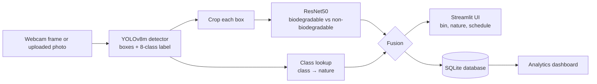

# 🗑️ Smart Waste Management System

An AI-powered Streamlit application that detects waste items from a **live webcam feed** or an **uploaded photo**, assigns each item to one of **8 waste classes**, tells you which **bin** it belongs in, and decides whether it is **biodegradable, non-biodegradable or hazardous**. Every observation is logged to a local database and shown on an analytics dashboard.


> **Disclaimer:** This is an academic / demonstration project. The portal-style interface is a design theme only. The project is not affiliated with, or endorsed by, any government body, and its bin assignments do not replace local municipal rules.

---

## 📑 Table of Contents

1. [Features](#-features)
2. [How It Works](#-how-it-works)
3. [Waste Classes](#-waste-classes)
4. [Quick Start](#-quick-start)
5. [Using the Application](#-using-the-application)
6. [Model Information](#-model-information)
7. [Project Structure](#-project-structure)
8. [Configuration](#-configuration)
9. [Troubleshooting](#-troubleshooting)
10. [Working as a Team](#-working-as-a-team)
11. [Future Enhancements](#-future-enhancements)

---

## 🌟 Features

- **Live webcam detection**: real-time bounding boxes with class, confidence and bin guidance
- **Photo upload analysis**: drag and drop JPG, PNG, BMP or GIF images
- **8 waste classes**: plastic, metal, glass, e-waste, medical waste, paper, cardboard, organic waste
- **Two-stage pipeline**: YOLOv8m finds and labels objects, and an optional ResNet50 double-checks biodegradability on each cropped object
- **Biodegradable / Non-biodegradable / Hazardous** label for every detection
- **Bin recommendation** and schedule reference for each class
- **Analytics dashboard**: totals, class distribution, confidence over time, source split and a downloadable CSV of the history
- **Adjustable confidence threshold** and camera selection in the sidebar
- **Works on CPU**, no GPU required

---

## ⚙️ How It Works



1. **Detection:** YOLOv8m finds every waste item and predicts one of 8 classes.
2. **Nature decision:** each class maps to a nature (for example paper → biodegradable). If the ResNet50 weights are present, each cropped item is also classified by ResNet50.
3. **Fusion:** if the class mapping and ResNet50 agree, that answer is used. If they disagree, the more confident one wins. `medical_waste` is always labelled **Hazardous**.
4. **Output:** the UI shows the bin and nature, and the detection is saved to SQLite for the dashboard.

If `models/resnet50_bio_best.pt` is missing, the app still works and uses the class mapping alone.

---

## 🗑️ Waste Classes

| Class | Icon | Bin | Nature | Notes |
|-------|------|-----|--------|-------|
| `plastic` | ♻️ | Yellow Bin | Non-Biodegradable | Recyclable plastic items |
| `metal` | 🔩 | Blue Bin | Non-Biodegradable | Metal items, including cans |
| `glass` | 🍾 | Green Bin | Non-Biodegradable | Bottles and containers |
| `e_waste` | 💻 | E-Waste Bin | Non-Biodegradable | Electronics, including cables |
| `medical_waste` | 💉 | Red Bin | **Hazardous** | Medical and hazardous waste |
| `paper` | 📄 | Blue Bin | Biodegradable | Paper and documents |
| `cardboard` | 📦 | Blue Bin | Biodegradable | Cardboard boxes |
| `organic_waste` | 🍃 | Green Bin | Biodegradable | Food and other organic waste |

---

## 🚀 Quick Start

### Prerequisites

| Requirement | Details |
|-------------|---------|
| **Python** | **3.10 or 3.11** (the pinned PyTorch 2.1.2 has no wheels for 3.12 or newer) |
| **Git** | To clone the repository |
| **Webcam** | Optional, only for live detection |
| **Disk space** | About 3 GB for the Python packages |

Check your Python version with `python --version`.

### 1. Clone the repository

```bash
git clone https://github.com/<your-username>/<your-repo-name>.git
cd <your-repo-name>
```

### 2. Create and activate a virtual environment

**Windows (Command Prompt)**
```bash
python -m venv venv
venv\Scripts\activate
```

**Windows (PowerShell)**
```powershell
python -m venv venv
venv\Scripts\Activate.ps1
```
If PowerShell blocks the script, run `Set-ExecutionPolicy -Scope CurrentUser RemoteSigned` once, or use Command Prompt instead.

**macOS / Linux**
```bash
python3 -m venv venv
source venv/bin/activate
```

You should now see `(venv)` at the start of your terminal line.

### 3. Install dependencies

```bash
python -m pip install --upgrade pip
python -m pip install -r requirements.txt
```

This takes several minutes because PyTorch is a large download.

> **Linux without an NVIDIA GPU:** add `--extra-index-url https://download.pytorch.org/whl/cpu` to the install command to get the smaller CPU build of PyTorch. Windows installs the CPU build by default.

### 4. Add the model files

Place the trained weights in the `models/` folder:

```
models/
├── best.pt                  # YOLOv8m detector (required)
└── resnet50_bio_best.pt     # ResNet50 biodegradability classifier (optional)
```

- `best.pt` is **required**. Without it the app opens but shows "The detection model could not be loaded".
- `resnet50_bio_best.pt` is **optional**. Without it, the app uses the class mapping for the biodegradable / non-biodegradable decision.
- If the files are not in the repository (GitHub rejects files over 100 MB), download them from: `<add-your-download-link-here>`

### 5. Run the application

```bash
python -m streamlit run app.py
```

The app opens in your browser at **http://localhost:8501**. To stop it, press `Ctrl + C` in the terminal.

The first detection can take a few seconds while the models load. After that they stay in memory.

### Check your installed versions (optional)

```bash
python -m pip list
```

Tested versions:

| Package | Version |
|---------|---------|
| streamlit | 1.58.0 |
| ultralytics | 8.1.0 |
| torch / torchvision | 2.1.2 / 0.16.2 |
| opencv-python | 4.9.0.80 |
| numpy | 1.26.3 |
| pillow | 10.2.0 |
| pandas | 2.3.3 |
| plotly | 6.7.0 |

---

## 🎯 Using the Application

### 📷 Live Camera Detection

1. Open the **Live Camera Detection** tab.
2. If you have more than one camera, set the **Camera Index** in the sidebar (0 is the default webcam, try 1 or 2 if it fails).
3. Click **▶ Start Detection**. Allow camera access if Windows or your browser asks.
4. Detected items are boxed on the video, and the panel on the right lists each item with its confidence, bin and nature.
5. Click **⏹ Stop** to release the camera.

### 📁 Photo Upload & Analysis

1. Open the **Photo Upload & Analysis** tab.
2. Upload a photo (PNG, JPG, JPEG, BMP or GIF).
3. The **Classification Report** lists each detected item with its bin, schedule and nature, and shows the annotated image with bounding boxes.

### 📊 Analytics Dashboard

Open **Analytics Dashboard** from the sidebar to see:

- Total detections, most common class and average confidence
- Counts of biodegradable, non-biodegradable and hazardous items
- Waste-nature split and detections per class
- Model confidence over time
- Webcam vs upload split and a class × source heatmap
- An activity log with separate tabs per nature
- **Download Full Detection History (CSV)** and a **Clear All History** button

### ⚙️ Sidebar Settings

| Setting | What it does |
|---------|--------------|
| **Confidence Threshold** (default 0.25) | Lower shows more detections but more false positives. Higher shows fewer, more certain detections. |
| **Camera Index** | Selects which camera to use for live detection. |

---

## 🧠 Model Information

| Item | Details |
|------|---------|
| **Detector** | YOLOv8m (Ultralytics), 8 classes, 640 px input |
| **Biodegradability classifier** | ResNet50 (ImageNet transfer learning), 224 px crops, 2 classes (optional stage) |
| **Training platform** | Kaggle (Tesla T4 GPU) |
| **Dataset** | Custom 8-class YOLO-format dataset (`balanced_v3`), class-balanced over three iterations; 6,502 train / 1,190 validation / 904 test images |
| **Fusion rule** | Agree → accept. Disagree → trust the more confident model. `medical_waste` → always Hazardous. |

### Results

<!-- Fill these from the metrics.json / results.csv produced by the final training run -->

| Metric (YOLOv8m, test split) | Value |
|------------------------------|-------|
| Precision | — |
| Recall | — |
| mAP@0.5 | — |
| mAP@0.5:0.95 | — |

| Biodegradability stage | Class lookup only | ResNet50 only | Fusion |
|------------------------|-------------------|---------------|--------|
| Accuracy on matched detections | — | — | — |

### Retraining

The training notebooks are in the `notebooks/` folder and are designed for Kaggle:

- `yolov8m_crashproof_training.ipynb` trains the detector. Run it with **Save & Run All (Commit)** so training continues even if your internet drops.
- `resnet50_yolov8_pipeline.ipynb` trains the ResNet50 classifier and compares class lookup, ResNet50 and fusion.

After training, copy the new weights into `models/` and restart the app.

---

## 📁 Project Structure

```
<your-repo-name>/
│
├── app.py                        # Main Streamlit app (live camera + photo upload)
├── waste_pipeline.py             # YOLOv8m + ResNet50 + fusion inference module
├── database.py                   # SQLite storage and dashboard queries
├── requirements.txt              # Pinned Python dependencies
├── README.md                     # This file
├── .gitignore                    # Files Git should ignore
│
├── pages/
│   └── dashboard.py              # Analytics dashboard page
│
├── models/
│   ├── best.pt                   # YOLOv8m detector (required)
│   └── resnet50_bio_best.pt      # ResNet50 classifier (optional)
│
├── notebooks/                    # Kaggle training notebooks
│   ├── yolov8m_crashproof_training.ipynb
│   └── resnet50_yolov8_pipeline.ipynb
│
├── .streamlit/
│   └── config.toml               # Streamlit settings (optional)
│
└── waste_data.db                 # Detection history (created automatically, not committed)
```

---

## 🔧 Configuration

| What | Where | Notes |
|------|-------|-------|
| Detector weights path | `load_model()` in `app.py` | Default `models/best.pt` |
| ResNet50 weights path | `load_model()` in `app.py` | Default `models/resnet50_bio_best.pt` |
| Max ResNet50 crops per frame | `max_resnet_crops` in `waste_pipeline.py` | Default 8. Lower it if live detection feels slow on CPU. |
| How often live detections are saved | `SAVE_EVERY_N_FRAMES` in `app.py` | Default 30 frames |
| Database file | `DB_PATH` in `database.py` | Default `waste_data.db` next to the code |
| Theme and server options | `.streamlit/config.toml` | Optional |

**Run on a different port:**
```bash
python -m streamlit run app.py --server.port 8502
```

**Database:** detections are stored in SQLite with these columns: `id`, `timestamp`, `source` (webcam or upload), `class_name`, `confidence`, `bin_label`, `waste_nature`. Delete `waste_data.db` (or use **Clear All History** on the dashboard) to start fresh.

---

## 🐛 Troubleshooting

| Problem | Fix |
|---------|-----|
| `pip install` fails at `torch==2.1.2` ("No matching distribution") | You are on Python 3.12 or newer. Install Python 3.10 or 3.11 and recreate the virtual environment. |
| `ModuleNotFoundError: plotly` (or another package) | The environment is not activated or the install did not finish. Activate `venv` and run `python -m pip install -r requirements.txt` again. |
| `The detection model could not be loaded` | Check that `models/best.pt` exists and the file is not empty. |
| Error loading `best.pt` (for example "Can't get attribute") | The weights were trained with a newer Ultralytics than the installed one. Run `python -m pip install -U ultralytics`, test the app, and update the version in `requirements.txt`. |
| App errors about `width='stretch'` | Streamlit is too old. This project needs Streamlit 1.51 or newer (pinned to 1.58.0). |
| `Could not open camera` | Close other apps using the camera (Teams, Zoom, browser tabs). Try Camera Index 1 or 2. On Windows, turn on Settings → Privacy & security → Camera → **Let desktop apps access your camera**. |
| Terminal shows `VIDEOIO(DSHOW)` errors | Windows camera backend messages. The app tries other backends automatically, so ignore them if the video appears. |
| Camera fails the second time you press Start | Press **Stop**, wait two seconds, then start again so the camera is released. |
| Live detection is slow | Lower `max_resnet_crops`, close other heavy programs, or remove `models/resnet50_bio_best.pt` to skip the second stage. |
| No detections found | Lower the confidence threshold, use better lighting, and make sure the item is one of the 8 classes. |
| `Port 8501 is already in use` | Close the old Streamlit window, or run with `--server.port 8502`. |
| Changes to model files are not picked up | Stop the app with `Ctrl + C` and start it again, because Streamlit caches loaded models. |

---

## 👥 Working as a Team

**First time (teammate):**
```bash
git clone https://github.com/<your-username>/<your-repo-name>.git
cd <your-repo-name>
python -m venv venv
venv\Scripts\activate
python -m pip install -r requirements.txt
python -m streamlit run app.py
```

**Getting the latest changes:**
```bash
git pull
python -m pip install -r requirements.txt   # only if requirements.txt changed
```

**Making changes:** create a branch (`git checkout -b feature-name`), commit and push it, open a pull request on GitHub, and merge after a teammate has reviewed it. Don't commit `venv/`, `__pycache__/`, `waste_data.db` or any API keys.

---

## 🔮 Future Enhancements

- [ ] Smoothing of detections across video frames to reduce flicker
- [ ] Faster CPU inference with ONNX export
- [ ] Batch processing of many images
- [ ] More waste classes and more real-world webcam training data
- [ ] PDF report export from the dashboard
- [ ] Multi-language interface
- [ ] REST API for third-party apps

---

## 🛠️ Technologies Used

- **Streamlit**: web application framework
- **Ultralytics YOLOv8**: object detection
- **PyTorch / torchvision**: ResNet50 classifier
- **OpenCV**: camera capture and drawing
- **SQLite**: detection history
- **Pandas / Plotly**: analytics dashboard
- **Pillow / NumPy**: image handling

---

## 📄 License

Released under the MIT License. See the `LICENSE` file for details.

## ✍️ Authors

- `<Your Name>` ([@your-github-username](https://github.com/your-github-username))
- `<Teammate Name>` ([@teammate-github-username](https://github.com/teammate-github-username))
